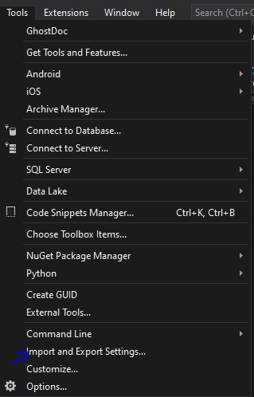
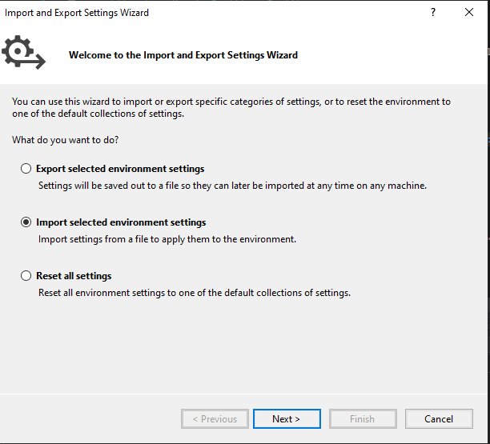
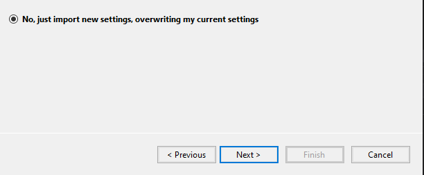
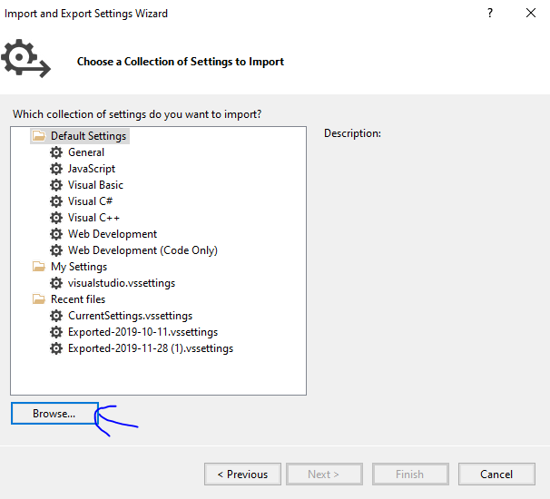
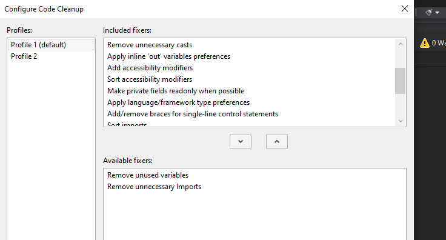

# &nbsp;**.NET Incubator Setup**

<br/><br/><br/>

- [ ] Setup your environment - [How to video](https://www.youtube.com/watch?v=G1-Zfr9-3zs&list=PLLWMQd6PeGY2GVsQZ-u3DPXqwwKW8MkiP)
  - [ ] [Visual Studio Community](https://visualstudio.microsoft.com/downloads/) — install the latest stable version
  - [ ] Install [`dotnetup`](https://learn.microsoft.com/dotnet/core/tools/dotnetup) to manage .NET SDKs locally
  - [ ] [.NET SDK (11.x)](https://dotnet.microsoft.com/download) — install .NET 11 SDK (or later)

## Manage SDK versions with dotnetup

The incubator pins its SDK through [`global.json`](./global.json). `dotnetup` can install
multiple SDK channels side by side and lets you switch the SDK used by this repository
without changing the machine-wide .NET installation.

Install `dotnetup` from PowerShell:

```powershell
irm https://aka.ms/dotnetup/get-dotnetup.ps1 | iex
dotnetup init
```

Install the SDK channels you want to use:

```powershell
dotnetup sdk install 11.0
dotnetup sdk install 10.0
dotnetup list
```

To switch the incubator to another installed SDK, change the `sdk.version` value in
[`global.json`](./global.json), then verify the selected SDK:

```powershell
dotnet --version
dotnet --info
```

For example, use `"version": "10.0.100"` to build with .NET 10, or restore
`"version": "11.0.100"` to use the current .NET 11 SDK. Keep the repository's
`global.json` aligned with the target frameworks and package versions before
committing a version change.

To update tracked SDK installations later:

```powershell
dotnetup update
```

See the [dotnetup announcement](https://devblogs.microsoft.com/dotnet/introducing-dotnetup/)
and [dotnetup documentation](https://learn.microsoft.com/dotnet/core/tools/dotnetup) for
additional commands and platform-specific installation instructions.

## Setup Visual Studio

- [ ] Update the default C# class template in Visual Studio — every time you create a new class it will use this template.
- [ ]  Open the following file in a text editor

```cmd
C:\Program Files (x86)\Microsoft Visual Studio\2022\Community\Common7\IDE\ItemTemplates\CSharp\Code\1033\Class\Class.cs
```

Change the template to the following: move using directives inside the namespace and declare `public` before the class.

```cs
namespace $rootnamespace$;

using System.Collections.Generic;
$if$ ($targetframeworkversion$ >= 3.5)using System.Linq;
$endif$using System.Text;
$if$ ($targetframeworkversion$ >= 4.5)using System.Threading.Tasks;
$endif$

public class $safeitemrootname$
{
}
```

Do the same with the Interface Template

```cmd
C:\Program Files (x86)\Microsoft Visual Studio\2022\Community\Common7\IDE\ItemTemplates\CSharp\Code\1033\Interface\Interface.cs
```

```cs
namespace $rootnamespace$;

using System.Collections.Generic;
$if$ ($targetframeworkversion$ >= 3.5)using System.Linq;
$endif$using System.Text;
$if$ ($targetframeworkversion$ >= 4.5)using System.Threading.Tasks;
$endif$

public interface $safeitemrootname$
{
}
```

- [ ] [Import new Settings](./Assets/visualstudio.vssettings)







Browse to **visualstudio.vssettings**



At the bottom of Visual Studio click on the broom and choose **Configure Code Cleanup**. Choose everything except the bottom 2.



Note: in Visual Studio you can press Ctrl+K then Ctrl+E to run Code Cleanup. This helps with consistency and clean code.

# Intro

- [ ] [Intro](https://github.com/entelect-incubator/.NET#intro)
